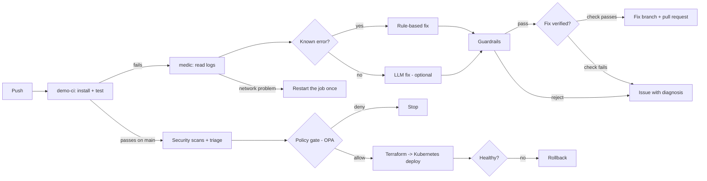

# pipeline-medic

[](https://github.com/ayushanand27/pipeline-medic/actions/workflows/ci.yml)
[](https://github.com/ayushanand27/pipeline-medic/actions/workflows/deploy.yml)
[](LICENSE)

When a CI build fails, pipeline-medic reads the logs, finds the root cause, proves the fix works, and opens a pull request. If the failure is only a network problem it restarts the job. If it cannot fix it safely, it opens an issue that explains what broke.

It also ships a full delivery pipeline for a small demo app: test, build a Docker image, scan it, pass a policy gate, create a Kubernetes cluster with Terraform, deploy, verify, and roll back if the new version is unhealthy.

The agent's abilities are also available as tools over the Model Context Protocol (MCP), so an IDE assistant or another agent can use them.



## How it works

1. **Trigger.** `medic.yml` runs when the `demo-ci` workflow finishes with a failure.
2. **Read.** The agent downloads the logs of the failed jobs through the GitHub REST API, and the list of files the failing commit changed.
3. **Parse.** `log_parser.py` uses plain regex to pull out what failed. This step is not an LLM, so it is cheap and gives the same answer every time.
4. **Decide.** There are three possible responses:
   - **Retry.** A timeout, a DNS error or a rate limit is not a code problem. The agent restarts the failed jobs once. If they fail again, it opens an issue.
   - **Fix.** `diagnose.py` has two layers. Rules handle errors with one known fix (a package missing from `requirements.txt`, or a package pinned to a version that does not exist). An optional LLM handles everything else, like a failing test. It gets the error and the files involved and must answer with exact search-and-replace edits.
   - **Escalate.** If there is no safe fix, the agent opens an issue with the diagnosis and changes nothing.
5. **Guardrails.** `guard.py` checks every plan in code before anything is written (see below).
6. **Verify.** `verify.py` applies the fix to a clean copy of the failing commit, in a fresh virtual environment, and runs the project's own check command. Only a fix that makes the check pass becomes a pull request. A fix that fails goes into an issue instead.
7. **Act.** The agent creates a branch `medic/fix-run-<id>`, commits the change and opens a labelled pull request with the root cause, the diff, the verification output and the log. A person reviews and merges it.

## Guardrails

The LLM is never trusted on its own. Code decides what is allowed.

| Rule | Why |
| --- | --- |
| Only files under `demo-app/` can be edited | The agent cannot change the pipeline, the deploy files or its own code |
| At most 3 files and 20 changed lines per fix | A CI fix should be small. A big change needs a person |
| Every LLM edit must match the file exactly, once | If the model did not copy the text exactly, the fix is dropped, not guessed |
| The fix must pass the project's check before a pull request | A fix that does not work is noise for the reviewer |
| The check runs without tokens or API keys | It executes code from the branch being repaired, so it gets no secrets |
| The agent code always comes from the default branch | A broken branch cannot change the agent that repairs it |
| The agent only opens pull requests | It never pushes to `main` and never merges |
| Runs on `medic/` branches are ignored | The agent cannot get stuck fixing its own fixes in a loop |
| One fix branch per failed run | The same failure is not handled twice |

## Try it

You need Python 3.12+.

```bash
pip install -r requirements.txt -r demo-app/requirements.txt
python -m pytest tests -q                    # agent tests
python -m pytest demo-app -q --rootdir .     # demo app tests
```

```bash
python -m evals.run                          # evaluation set, see below
```

**Dry run on a saved log (no GitHub needed):**

```bash
python scripts/plant_bug.py bad-pin
python -m medic --log-file tests/fixtures/bad_pin.log
git checkout demo-app/requirements.txt
```

**See it on GitHub:**

1. In the repo go to Settings → Actions → General → Workflow permissions and tick **Allow GitHub Actions to create and approve pull requests**. (Without it the fix branch is still pushed, and the agent opens an issue that links to it.)
2. Plant a bug on a new branch and push it:

   ```bash
   git checkout -b break-the-build
   python scripts/plant_bug.py missing-dep     # or: bad-pin, logic-bug
   git commit -am "break the build" && git push -u origin break-the-build
   ```

3. `demo-ci` fails, `medic` runs, and a pull request appears against your branch.

`missing-dep` and `bad-pin` are fixed by rules and need no API key. `logic-bug` needs the LLM step. Without it, the agent opens an issue with the diagnosis.

**Turn on the LLM step (optional).** Any OpenAI-compatible API works. In Settings → Secrets and variables → Actions add the secret `LLM_API_KEY` and the variables `LLM_BASE_URL` and `LLM_MODEL`.

## Use it in another repository

The agent is packaged as a GitHub Action. Add this workflow to a repo and point it at your CI workflow:

```yaml
name: medic
on:
  workflow_run:
    workflows: ["CI"]          # the workflow to watch
    types: [completed]
permissions:
  actions: write
  contents: write
  pull-requests: write
  issues: write
jobs:
  fix:
    if: github.event.workflow_run.conclusion == 'failure' && !startsWith(github.event.workflow_run.head_branch, 'medic/')
    runs-on: ubuntu-latest
    steps:
      - uses: actions/checkout@v4
        with:
          ref: ${{ github.event.workflow_run.head_sha }}
      - uses: ayushanand27/pipeline-medic@main
        with:
          run-id: ${{ github.event.workflow_run.id }}
          github-token: ${{ secrets.GITHUB_TOKEN }}
          verify-command: pip install -r requirements.txt && pytest
          allowed-paths: src/,tests/
          requirements-paths: requirements.txt
```

## Evaluation set

Unit tests check single functions. `evals/` checks the behaviour a user cares about: for a given failed build, does the agent pick the right response (fix, retry or escalate)?

There are 12 cases: 3 use real captured logs, 9 use short hand-written logs for one situation each (for example a real error next to a harmless retry warning, or an out-of-memory kill the agent does not know). CI fails if any case is wrong.

Current score: 12/12. These cases were written together with the rules, so this is a regression gate, not an independent benchmark. The LLM layer is not part of the score yet.

## Delivery pipeline

`deploy.yml` runs on every push to `main` that touches the app, the deploy files or the policy. Each step must pass before the next one starts.

1. **Build.** Builds the Docker image. The container runs as a non-root user.
2. **Security scans.** Three scanners, each for a different kind of problem:
   - Trivy: known vulnerabilities in the image and in the dependencies.
   - Bandit: risky patterns in the Python code.
   - [LeakKill](https://github.com/ayushanand27/leakkill): secrets committed to the repo.
3. **Triage.** `medic/triage.py` merges the three reports and removes duplicates (the same CVE reported for the same package by two scans counts once). It then adds exploit data from two public sources: the CISA KEV list (vulnerabilities being attacked right now) and EPSS (the chance of attack in the next 30 days). The ranking is: exploited now, then severity, then EPSS, then fixable before not fixable. The result is shown on the run's summary page.
4. **Policy gate.** Open Policy Agent checks `policy/deploy.rego`. The release is stopped if a container has no resource limits, no readiness probe, no fixed image tag, runs privileged or has fewer than 2 replicas, or if the triage found a secret, a critical vulnerability that has a fix, or any vulnerability that is being exploited right now and has a fix.
5. **Cluster.** `terraform apply` creates a Kubernetes cluster ([kind](https://kind.sigs.k8s.io/), Kubernetes inside Docker). It lives inside the CI runner, so it costs nothing.
6. **Deploy.** Applies the manifests: 2 replicas, rolling update with `maxUnavailable: 0`, readiness and liveness probes, CPU and memory limits.
7. **Verify.** `verify.sh` waits for the rollout, calls `/health`, then sends 20 real requests and allows zero errors. If anything fails it runs `kubectl rollout undo`.
8. **Metric check.** Prometheus runs in the cluster and collects a request counter from every pod. The pipeline asks it for the error rate of the new release and rolls back if more than 1% of requests are server errors.
9. **Rollback drill.** On every run the pipeline ships a broken release on purpose and checks that it is caught and rolled back, and that the good version is still serving. So the rollback is tested, not assumed.

Run it on your own machine (needs Docker, kind, kubectl and Terraform):

```bash
docker build -t demo-app:local demo-app
terraform -chdir=deploy/terraform init && terraform -chdir=deploy/terraform apply -auto-approve
export KUBECONFIG="$(terraform -chdir=deploy/terraform output -raw kubeconfig_path)"
kind load docker-image demo-app:local --name pipeline-medic
./deploy/deploy.sh demo-app:local && kubectl apply -f deploy/k8s/prometheus.yaml
./deploy/verify.sh && ./deploy/metrics_check.sh
./deploy/rollback_drill.sh
terraform -chdir=deploy/terraform destroy -auto-approve    # clean up
```

## MCP server

`medic/mcp_server.py` exposes three tools:

| Tool | What it does | Writes? |
| --- | --- | --- |
| `list_failed_runs` | Recent failed CI runs | No |
| `explain_failure` | The error, the root cause and the proposed fix as a diff | No |
| `open_fix` | Pushes the fix on a new branch and opens a pull request | Yes |

Reading and writing are separate tools on purpose, so a client can ask "why did it fail?" without changing anything.

```bash
pip install -r requirements-mcp.txt
GITHUB_TOKEN=... MEDIC_REPO=owner/name python -m medic.mcp_server
```

Example client config (stdio):

```json
{
  "mcpServers": {
    "pipeline-medic": {
      "command": "python",
      "args": ["-m", "medic.mcp_server"],
      "env": {"GITHUB_TOKEN": "...", "MEDIC_REPO": "owner/name"}
    }
  }
}
```

## Dependencies

Every install uses exact versions and file hashes, so a build today and a build next month get the same packages, and a tampered package is refused.

- `requirements.txt`, `requirements-mcp.txt` and `requirements-scan.txt` are generated from the matching `.in` files.
- The Docker image installs from `demo-app/requirements.lock`, generated from `demo-app/requirements.txt`. A CI job fails if the two drift apart.
- Installs use `--require-hashes`, so pip rejects any file whose hash is not in the lock, and `--only-binary :all:`, so pip never runs a package's own setup script.

Refresh after changing a dependency:

```bash
pip install uv
uv pip compile requirements.in --python-version 3.12 --no-header --generate-hashes -o requirements.txt
uv pip compile demo-app/requirements.txt --python-version 3.12 --no-header --generate-hashes -o demo-app/requirements.lock
```

`demo-ci` installs from the loose `demo-app/requirements.txt` on purpose. That file is what the planted bugs break and what the agent repairs.

## Layout

```
medic/                 the agent
  log_parser.py        raw log -> structured failure (regex)
  diagnose.py          rules first, optional LLM second
  guard.py             safety checks on every plan
  github_client.py     GitHub REST API calls
  verify.py            apply the fix to a clean copy and run the project's check
  agent.py             the loop: read -> decide -> check -> verify -> PR, retry or issue
  tools.py             the agent's abilities as plain functions
  mcp_server.py        the same abilities as MCP tools
  triage.py            merge, de-duplicate and rank scanner reports
evals/                 12 failed-build cases and the expected response for each
policy/                OPA rules for a release, with their own tests
action.yml             the agent as a reusable GitHub Action
tests/                 97 tests (96% coverage), with real captured failure logs as fixtures
demo-app/              small FastAPI service the pipeline builds, tests and deploys
deploy/                Terraform (cluster), Kubernetes manifests (app + Prometheus), deploy, verify, metric check and rollback drill scripts
scripts/plant_bug.py   breaks the demo app on purpose, three ways
.github/workflows/     ci, demo-ci, medic, deploy
```

## Tests

- **97 agent tests, 96% line coverage.** CI fails under 90%. They cover log parsing on real captured logs, both rule-based fixes, LLM answers that are good, malformed or unsafe, every guardrail, the whole loop against a fake GitHub, fix verification against a real temporary git repository, retries, the triage and exploit ranking, the metric check, and the MCP server through a real MCP client.
- **12 evaluation cases.** See above.
- **Lint.** `ruff` with its security rules runs on every push.
- **10 policy tests.** One for a good release and one for each rule.
- **11 demo app tests.** Price rules, the HTTP API and the metrics.
- **In the pipeline itself.** The rollback drill runs on every deploy.

## Known limits

- The rules cover two Python dependency errors. Other failures need the LLM step or end as an issue.
- The LLM step is tested with recorded answers, not yet against a live model.
- Only Python projects and pytest output are understood today.
- Verification runs on the CI runner, not in a locked-down sandbox. It gets no secrets, but it does have network access.
- The cluster is a local kind cluster, not a cloud cluster (EKS, GKE, AKS).
- The security gate reports findings. It does not open fix pull requests for them yet.
- The metric check looks at the error rate only. It does not compare latency, and it is not a canary that shifts traffic step by step.
- Pull requests opened with the default `GITHUB_TOKEN` do not start new workflow runs. This is a GitHub rule. Re-run the checks by hand, or use a GitHub App token.

## Roadmap

- Fix pull requests for vulnerable dependencies (bump to the fixed version).
- Canary releases: send a small share of traffic to the new version first and compare its metrics with the old one.
- The same Terraform flow against a managed cloud cluster.
