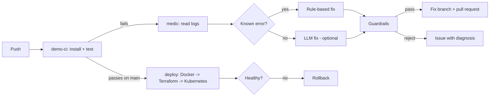

# pipeline-medic

When a CI build fails, pipeline-medic reads the logs, finds the root cause and opens a pull request with the fix. If it cannot fix it safely, it opens an issue that explains what broke.

It also ships a full delivery pipeline for a small demo app: test, build a Docker image, create a Kubernetes cluster with Terraform, deploy, verify, and roll back if the new version is unhealthy.



## How it works

1. **Trigger.** `medic.yml` runs when the `demo-ci` workflow finishes with a failure.
2. **Read.** The agent downloads the logs of the failed jobs through the GitHub REST API.
3. **Parse.** `log_parser.py` uses plain regex to pull out what failed. This step is not an LLM, so it is cheap and gives the same answer every time.
4. **Diagnose.** `diagnose.py` has two layers:
   - **Rules** for errors with one known fix: a package missing from `requirements.txt`, or a package pinned to a version that does not exist.
   - **LLM** (optional) for everything else, like a failing test. It gets the error and the files involved and must answer with exact search-and-replace edits.
5. **Guardrails.** `guard.py` checks every plan in code before anything is written (see below).
6. **Act.** The agent creates a branch `medic/fix-run-<id>`, commits the change and opens a pull request with the root cause, the diff and the log. A person reviews and merges it.

## Guardrails

The LLM is never trusted on its own. Code decides what is allowed.

| Rule | Why |
| --- | --- |
| Only files under `demo-app/` can be edited | The agent cannot change the pipeline, the deploy files or its own code |
| At most 3 files and 20 changed lines per fix | A CI fix should be small. A big change needs a person |
| Every LLM edit must match the file exactly, once | If the model did not copy the text exactly, the fix is dropped, not guessed |
| The agent only opens pull requests | It never pushes to `main` and never merges |
| Runs on `medic/` branches are ignored | The agent cannot get stuck fixing its own fixes in a loop |
| One fix branch per failed run | The same failure is not handled twice |

## Try it

You need Python 3.12+.

```bash
pip install -r requirements.txt -r demo-app/requirements.txt
python -m pytest tests -q                    # agent tests
python -m pytest demo-app -q --rootdir .     # demo app tests
```

**Dry run on a saved log (no GitHub needed):**

```bash
python scripts/plant_bug.py bad-pin
python -m medic --log-file tests/fixtures/bad_pin.log
git checkout demo-app/requirements.txt
```

**See it on GitHub:**

1. In the repo go to Settings → Actions → General → Workflow permissions and tick **Allow GitHub Actions to create and approve pull requests**. (Without it the fix branch is still pushed, and the agent opens an issue that links to it.)
2. Plant a bug on a new branch and push it:

   ```bash
   git checkout -b break-the-build
   python scripts/plant_bug.py missing-dep     # or: bad-pin, logic-bug
   git commit -am "break the build" && git push -u origin break-the-build
   ```

3. `demo-ci` fails, `medic` runs, and a pull request appears against your branch.

`missing-dep` and `bad-pin` are fixed by rules and need no API key. `logic-bug` needs the LLM step. Without it, the agent opens an issue with the diagnosis.

**Turn on the LLM step (optional).** Any OpenAI-compatible API works. In Settings → Secrets and variables → Actions add the secret `LLM_API_KEY` and the variables `LLM_BASE_URL` and `LLM_MODEL`.

## Deploy pipeline

`deploy.yml` runs on every push to `main` that touches the app or the deploy files:

1. Builds the Docker image (the container runs as a non-root user).
2. `terraform apply` creates a Kubernetes cluster ([kind](https://kind.sigs.k8s.io/), Kubernetes inside Docker). It lives inside the CI runner, so it costs nothing.
3. Applies the manifests: 2 replicas, rolling update with `maxUnavailable: 0`, readiness and liveness probes on `/health`, CPU and memory limits.
4. `verify.sh` waits for the rollout and calls `/health` through the Service. If either fails, it runs `kubectl rollout undo` and the job fails.

Run it on your own machine (needs Docker, kind, kubectl and Terraform):

```bash
docker build -t demo-app:local demo-app
terraform -chdir=deploy/terraform init && terraform -chdir=deploy/terraform apply -auto-approve
export KUBECONFIG="$(terraform -chdir=deploy/terraform output -raw kubeconfig_path)"
kind load docker-image demo-app:local --name pipeline-medic
./deploy/deploy.sh demo-app:local && ./deploy/verify.sh
terraform -chdir=deploy/terraform destroy -auto-approve    # clean up
```

## Layout

```
medic/                 the agent
  log_parser.py        raw log -> structured failure (regex)
  diagnose.py          rules first, optional LLM second
  guard.py             safety checks on every plan
  github_client.py     GitHub REST API calls
  agent.py             the loop: read -> diagnose -> check -> PR or issue
tests/                 37 tests, with real captured failure logs as fixtures
demo-app/              small FastAPI service the pipeline builds, tests and deploys
deploy/                Terraform (cluster), Kubernetes manifests, deploy + verify scripts
scripts/plant_bug.py   breaks the demo app on purpose, three ways
.github/workflows/     ci, demo-ci, medic, deploy
```

## Tests

- **37 agent tests.** Log parsing on real captured logs, both rule-based fixes, LLM answers that are good, malformed or unsafe, every guardrail, and the whole loop against a fake GitHub (pull request, issue, loop protection, no double handling).
- **9 demo app tests.** Price rules and the HTTP API.

## Known limits

- The rules cover two Python dependency errors. Other failures need the LLM step or end as an issue.
- Only Python projects and pytest output are understood today.
- The cluster is a local kind cluster, not a cloud cluster (EKS, GKE, AKS).
- Pull requests opened with the default `GITHUB_TOKEN` do not start new workflow runs. This is a GitHub rule. Re-run the checks by hand, or use a GitHub App token.
- Verification is a health check. It does not compare metrics before and after a deploy.

## Roadmap

- MCP server so an IDE or CI runner can call the agent's tools (get logs, diagnose, open PR).
- Security gate: image scan with Trivy and secret scan with [LeakKill](https://github.com/ayushanand27/leakkill), with duplicate findings merged and ranked.
- Policy gate with OPA/Rego before deploy.
- Metric-based verification after deploy.
