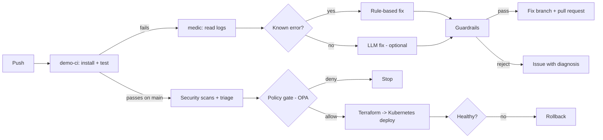

# pipeline-medic

When a CI build fails, pipeline-medic reads the logs, finds the root cause and opens a pull request with the fix. If it cannot fix it safely, it opens an issue that explains what broke.

It also ships a full delivery pipeline for a small demo app: test, build a Docker image, scan it, pass a policy gate, create a Kubernetes cluster with Terraform, deploy, verify, and roll back if the new version is unhealthy.

The agent's abilities are also available as tools over the Model Context Protocol (MCP), so an IDE assistant or another agent can use them.



## How it works

1. **Trigger.** `medic.yml` runs when the `demo-ci` workflow finishes with a failure.
2. **Read.** The agent downloads the logs of the failed jobs through the GitHub REST API.
3. **Parse.** `log_parser.py` uses plain regex to pull out what failed. This step is not an LLM, so it is cheap and gives the same answer every time.
4. **Diagnose.** `diagnose.py` has two layers:
   - **Rules** for errors with one known fix: a package missing from `requirements.txt`, or a package pinned to a version that does not exist.
   - **LLM** (optional) for everything else, like a failing test. It gets the error and the files involved and must answer with exact search-and-replace edits.
5. **Guardrails.** `guard.py` checks every plan in code before anything is written (see below).
6. **Act.** The agent creates a branch `medic/fix-run-<id>`, commits the change and opens a pull request with the root cause, the diff and the log. A person reviews and merges it.

## Guardrails

The LLM is never trusted on its own. Code decides what is allowed.

| Rule | Why |
| --- | --- |
| Only files under `demo-app/` can be edited | The agent cannot change the pipeline, the deploy files or its own code |
| At most 3 files and 20 changed lines per fix | A CI fix should be small. A big change needs a person |
| Every LLM edit must match the file exactly, once | If the model did not copy the text exactly, the fix is dropped, not guessed |
| The agent only opens pull requests | It never pushes to `main` and never merges |
| Runs on `medic/` branches are ignored | The agent cannot get stuck fixing its own fixes in a loop |
| One fix branch per failed run | The same failure is not handled twice |

## Try it

You need Python 3.12+.

```bash
pip install -r requirements.txt -r demo-app/requirements.txt
python -m pytest tests -q                    # agent tests
python -m pytest demo-app -q --rootdir .     # demo app tests
```

**Dry run on a saved log (no GitHub needed):**

```bash
python scripts/plant_bug.py bad-pin
python -m medic --log-file tests/fixtures/bad_pin.log
git checkout demo-app/requirements.txt
```

**See it on GitHub:**

1. In the repo go to Settings → Actions → General → Workflow permissions and tick **Allow GitHub Actions to create and approve pull requests**. (Without it the fix branch is still pushed, and the agent opens an issue that links to it.)
2. Plant a bug on a new branch and push it:

   ```bash
   git checkout -b break-the-build
   python scripts/plant_bug.py missing-dep     # or: bad-pin, logic-bug
   git commit -am "break the build" && git push -u origin break-the-build
   ```

3. `demo-ci` fails, `medic` runs, and a pull request appears against your branch.

`missing-dep` and `bad-pin` are fixed by rules and need no API key. `logic-bug` needs the LLM step. Without it, the agent opens an issue with the diagnosis.

**Turn on the LLM step (optional).** Any OpenAI-compatible API works. In Settings → Secrets and variables → Actions add the secret `LLM_API_KEY` and the variables `LLM_BASE_URL` and `LLM_MODEL`.

## Delivery pipeline

`deploy.yml` runs on every push to `main` that touches the app, the deploy files or the policy. Each step must pass before the next one starts.

1. **Build.** Builds the Docker image. The container runs as a non-root user.
2. **Security scans.** Three scanners, each for a different kind of problem:
   - Trivy: known vulnerabilities in the image and in the dependencies.
   - Bandit: risky patterns in the Python code.
   - [LeakKill](https://github.com/ayushanand27/leakkill): secrets committed to the repo.
3. **Triage.** `medic/triage.py` merges the three reports, removes duplicates (the same CVE reported for the same package by two scans counts once) and ranks them: worst severity first, and fixable before not fixable. The result is shown on the run's summary page.
4. **Policy gate.** Open Policy Agent checks `policy/deploy.rego`. The release is stopped if a container has no resource limits, no readiness probe, no fixed image tag, runs privileged or has fewer than 2 replicas, or if the triage found a secret or a critical vulnerability that has a fix.
5. **Cluster.** `terraform apply` creates a Kubernetes cluster ([kind](https://kind.sigs.k8s.io/), Kubernetes inside Docker). It lives inside the CI runner, so it costs nothing.
6. **Deploy.** Applies the manifests: 2 replicas, rolling update with `maxUnavailable: 0`, readiness and liveness probes, CPU and memory limits.
7. **Verify.** `verify.sh` waits for the rollout, calls `/health`, then sends 20 real requests and allows zero errors. If anything fails it runs `kubectl rollout undo`.
8. **Rollback drill.** On every run the pipeline ships a broken release on purpose and checks that it is caught and rolled back, and that the good version is still serving. So the rollback is tested, not assumed.

Run it on your own machine (needs Docker, kind, kubectl and Terraform):

```bash
docker build -t demo-app:local demo-app
terraform -chdir=deploy/terraform init && terraform -chdir=deploy/terraform apply -auto-approve
export KUBECONFIG="$(terraform -chdir=deploy/terraform output -raw kubeconfig_path)"
kind load docker-image demo-app:local --name pipeline-medic
./deploy/deploy.sh demo-app:local && ./deploy/verify.sh
./deploy/rollback_drill.sh
terraform -chdir=deploy/terraform destroy -auto-approve    # clean up
```

## MCP server

`medic/mcp_server.py` exposes three tools:

| Tool | What it does | Writes? |
| --- | --- | --- |
| `list_failed_runs` | Recent failed CI runs | No |
| `explain_failure` | The error, the root cause and the proposed fix as a diff | No |
| `open_fix` | Pushes the fix on a new branch and opens a pull request | Yes |

Reading and writing are separate tools on purpose, so a client can ask "why did it fail?" without changing anything.

```bash
pip install -r requirements-mcp.txt
GITHUB_TOKEN=... MEDIC_REPO=owner/name python -m medic.mcp_server
```

Example client config (stdio):

```json
{
  "mcpServers": {
    "pipeline-medic": {
      "command": "python",
      "args": ["-m", "medic.mcp_server"],
      "env": {"GITHUB_TOKEN": "...", "MEDIC_REPO": "owner/name"}
    }
  }
}
```

## Layout

```
medic/                 the agent
  log_parser.py        raw log -> structured failure (regex)
  diagnose.py          rules first, optional LLM second
  guard.py             safety checks on every plan
  github_client.py     GitHub REST API calls
  agent.py             the loop: read -> diagnose -> check -> PR or issue
  tools.py             the agent's abilities as plain functions
  mcp_server.py        the same abilities as MCP tools
  triage.py            merge, de-duplicate and rank scanner reports
policy/                OPA rules for a release, with their own tests
tests/                 51 tests, with real captured failure logs as fixtures
demo-app/              small FastAPI service the pipeline builds, tests and deploys
deploy/                Terraform (cluster), Kubernetes manifests, deploy, verify and rollback drill scripts
scripts/plant_bug.py   breaks the demo app on purpose, three ways
.github/workflows/     ci, demo-ci, medic, deploy
```

## Tests

- **51 agent tests.** Log parsing on real captured logs, both rule-based fixes, LLM answers that are good, malformed or unsafe, every guardrail, the whole loop against a fake GitHub, the triage logic, and the MCP server through a real MCP client.
- **9 policy tests.** One for a good release and one for each rule.
- **10 demo app tests.** Price rules and the HTTP API.
- **In the pipeline itself.** The rollback drill runs on every deploy.

## Known limits

- The rules cover two Python dependency errors. Other failures need the LLM step or end as an issue.
- The LLM step is tested with recorded answers, not yet against a live model.
- Only Python projects and pytest output are understood today.
- The cluster is a local kind cluster, not a cloud cluster (EKS, GKE, AKS).
- Triage ranks by severity and whether a fix exists. It does not use exploit data such as EPSS or the CISA KEV list.
- The security gate reports findings. It does not open fix pull requests for them yet.
- Verification is a health check plus a smoke test. It does not read metrics from a monitoring system.
- Pull requests opened with the default `GITHUB_TOKEN` do not start new workflow runs. This is a GitHub rule. Re-run the checks by hand, or use a GitHub App token.

## Roadmap

- Fix pull requests for vulnerable dependencies (bump to the fixed version).
- Metric-based verification after deploy (Prometheus).
- Rank vulnerabilities with exploit data (EPSS, CISA KEV).
- The same Terraform flow against a managed cloud cluster.
